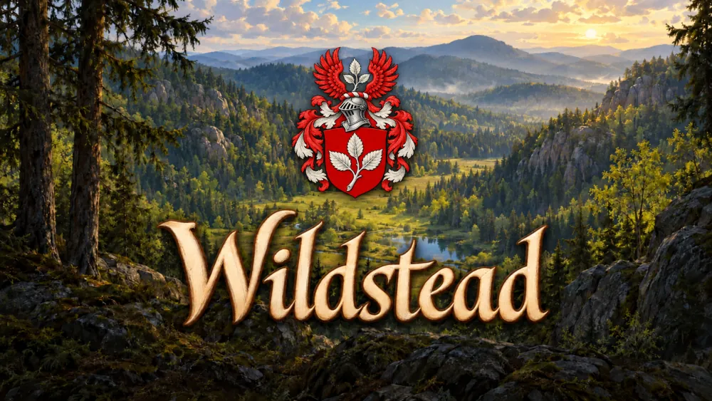
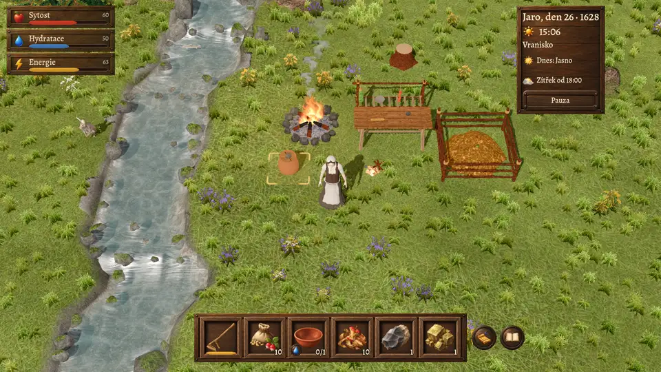
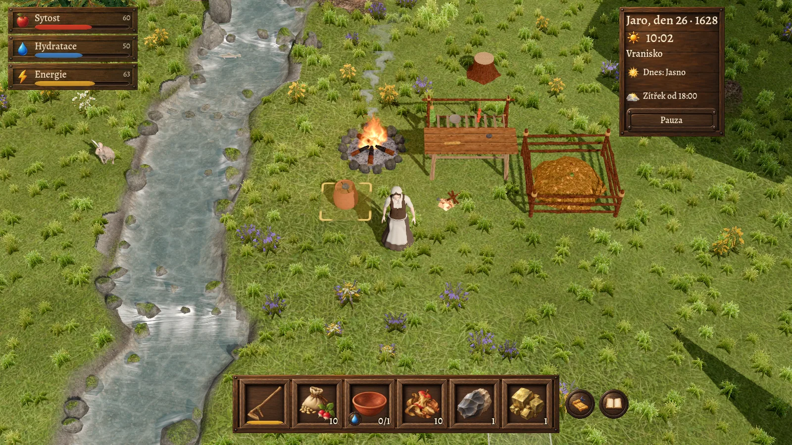
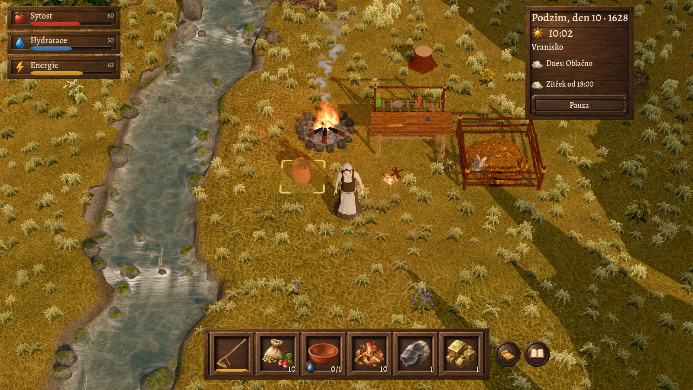
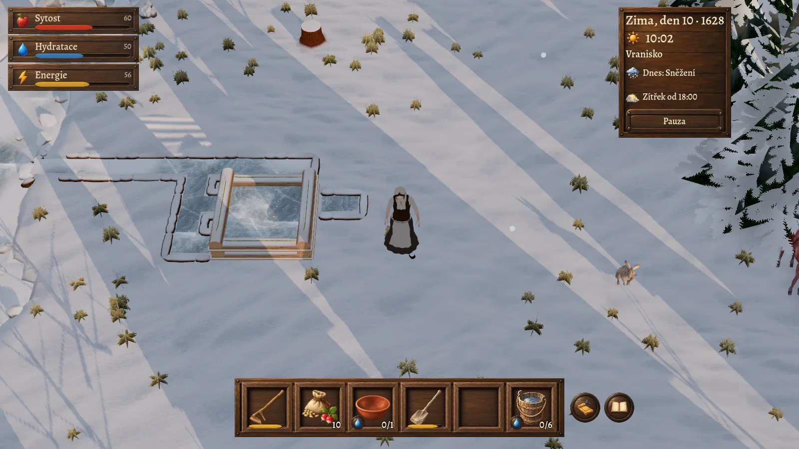
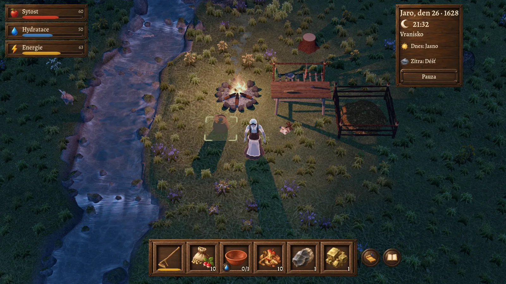
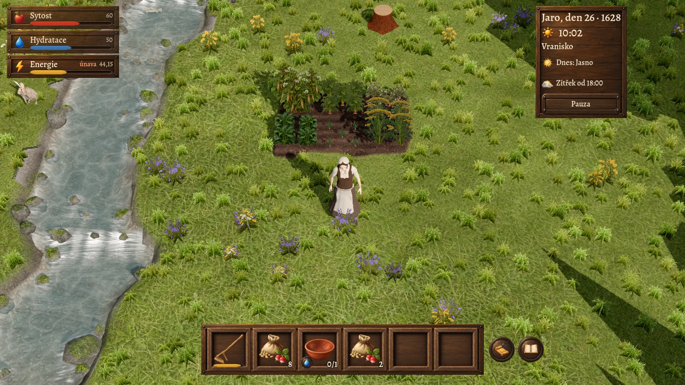
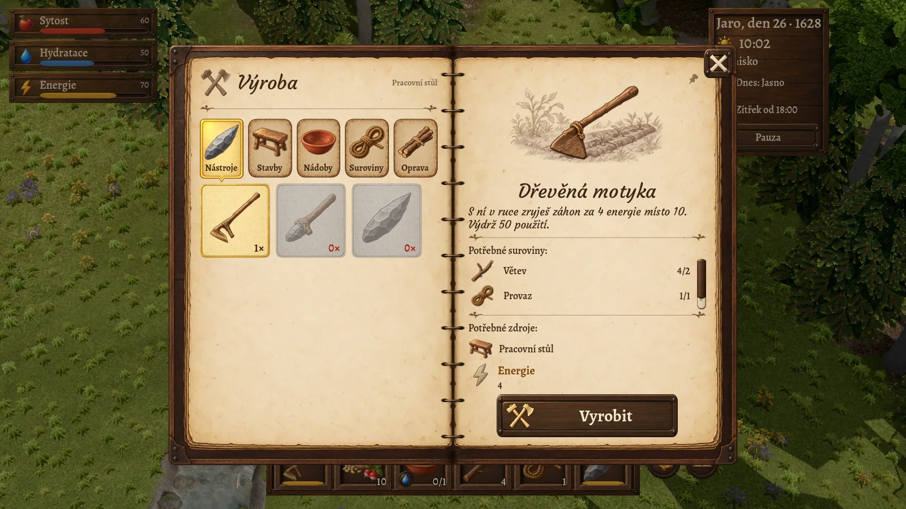
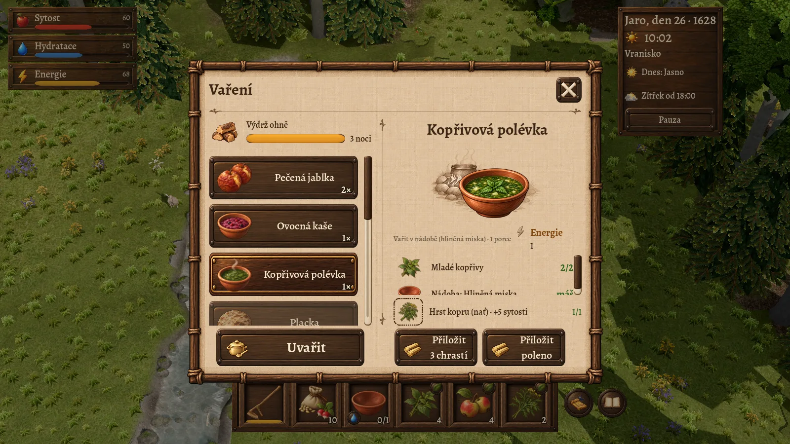

<h1 align="center">Přežij první noc. Vypěstuj si budoucnost.</h1>

  Survival hra pro jednoho hráče o hledání domova, síle přírody a radosti z vlastní úrody. 
  Začínáš s prázdnýma rukama v divokém údolí. Skončíš s vlastní zahradou, zásobami na zimu 
  a odrůdami, jaké nikde jinde nerostou.

  <kbd>Survival</kbd>&nbsp;
  <kbd>Zahradničení</kbd>&nbsp;
  <kbd>Šlechtění rostlin</kbd>&nbsp;
  <kbd>Výroba</kbd>&nbsp;
  <kbd>Roční období</kbd>&nbsp;
  <kbd>Pro jednoho hráče</kbd>&nbsp;
  <kbd>Offline</kbd>

  <strong>macOS · Windows</strong> &nbsp;|&nbsp; <strong>Čeština</strong> &nbsp;|&nbsp; <strong>Beta 1 se připravuje</strong>

  🔔 Zapni nahoře <strong>Watch → Custom → Releases</strong> a GitHub ti dá vědět, až bude Beta 1 ke stažení.

  

<table>
  <tr>
    <td width="33%"></td>
    <td width="33%"></td>
    <td width="33%"></td>
  </tr>
</table>

## O hře

Za lesy a skalami leží údolí, kde může začít nový život. Zatím máš ale prázdné ruce a před sebou první noc.

Ve **Wildsteadu** si cestu od přežívání k soběstačnosti vyšlapeš sám. Najdeš vodu, poznáš jedlé rostliny, vyrobíš první nástroje a založíš zahradu. Z několika nasbíraných soust postupně vzniknou zásoby. Z provizorního úkrytu místo, kam se budeš chtít vracet.

Každý den přináší malá rozhodnutí. Vydat se dál do lesa, nebo se postarat o záhony? Sníst poslední úrodu, nebo si nechat osivo? Příroda ti dá příležitost. Co z ní vypěstuješ, je na tobě.

---

### 🔥 Přežij první noc

Hlad, žízeň a únava tě naučí plánovat den. Než se setmí, potřebuješ vodu, něco k jídlu a oheň, který vydrží do rána. Každá plná zásobárna je malé vítězství.

### 🌱 Vyšlechti si vlastní odrůdy

Každá rostlina v údolí je jiná. Planá mrkev nebo hrách mají svůj výnos, rychlost zrání, odolnost vůči suchu a skladovatelnost a předávají je semenům. Vybírej nejlepší rostliny, sázej je vedle sebe, ať se zkříží, a sleduj, co vyroste v další generaci. Nejlepší odrůdy v přírodě nenajdeš, ty si musíš vypěstovat sám.

### 🪓 Vyrob si všechno, co potřebuješ

Od kamenné sekery přes hliněné misky až po sušák a kompost. Recepty objevuješ praxí a zapisuješ si je do deníku. Z nasbíraných bylin a úrody uvaříš polévky, kaše a pečená jablka, která tě zasytí na dlouhé dny.

<table>
  <tr>
    <td width="50%"></td>
    <td width="50%"></td>
  </tr>
</table>

### 🍂 Rok, který se mění

Jaro, léto, podzim a zima. Každé období mění krajinu i to, co tě čeká: kdy sít, kdy sklízet a co si odložit na zimu, kdy voda zamrzne a příroda se uloží ke spánku. Poznávej, co kde roste, a vracej se ve správnou chvíli.

### 🏡 Vlastním tempem

Hraješ sám a offline, bez připojení k internetu. Když hru zavřeš, svět počká na tvůj návrat.

---

## Systémové požadavky

| | macOS | Windows |
|---|---|---|
| **Systém** | macOS 11 Big Sur nebo novější | Upřesníme s Betou 1 |
| **Procesor** | Apple Silicon i Intel | Upřesníme s Betou 1 |
| **Místo na disku** | přibližně 300 MB | Upřesníme s Betou 1 |

*Požadavky jsou předběžné. Přesné hodnoty uvedeme s první betou.*

## Na cestě k vydání

| Etapa | Co to znamená |
|---|---|
| **Beta 1** · připravujeme | První veřejný test po dokončení současných oprav |
| **Beta 2** | Test celého rozsahu základní hry |
| **Vydání základní hry** | Po druhé betě a opravě nalezených chyb |
| **Další dobrodružství** | Samostatná rozšíření v pozdějších aktualizacích |

## Chceš být u toho?

- **Dej repozitáři ⭐**, ať ho snadno najdeš.
- **Zapni Watch → Custom → Releases**, ať ti neunikne žádná nová verze.
- **[Napiš nápad nebo nahlas chybu](https://github.com/pierotto/Wildstead-releases/issues).** U chyby přidej verzi hry, zařízení a kroky, jak ji zopakovat.

Až začneš testovat, napiš nám, co tě bavilo a kde ses zasekl. Každá zpráva pomáhá.

<strong>Časté otázky</strong>

**Přijdu s novou verzí o rozehranou hru?**
Ne. Od prvního veřejného buildu se rozehrané hry zachovají i v novějších verzích, i když některou aktualizaci přeskočíš.

**Kde najdu starší verze?**
Ke stažení držíme jen poslední vydanou verzi, aby nikdo omylem nehrál starou.

**Bude hra i na iPadu?**
Plánujeme ji. Podrobnosti oznámíme samostatně.

